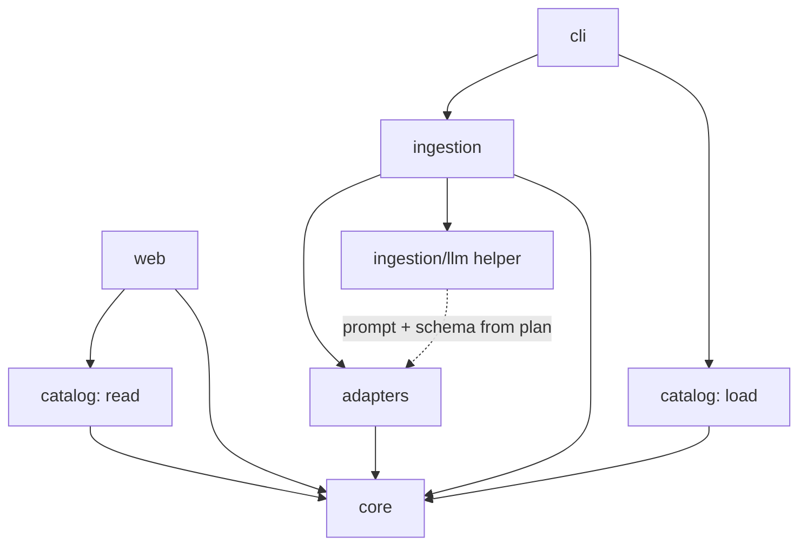
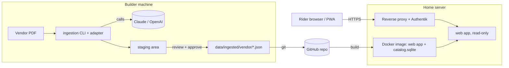
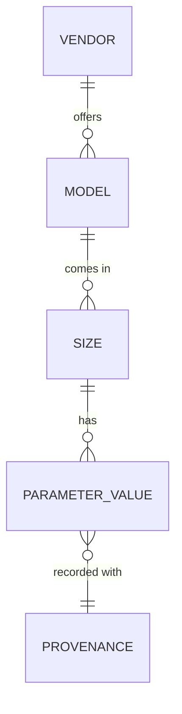

# Architecture Spine — Fit my Ride

## Design Paradigm

**Functional core / imperative shell.** All meaning (units, mapping, arbitration, fit evaluation) is pure functions with no I/O. Two shells — the web app and the ingestion CLI — do I/O and call the core. Vendor knowledge lives only in per-vendor **adapters**.

| Layer | Namespace | May do I/O |
| --- | --- | --- |
| Core | `core/` | never |
| Adapters | `adapters/<vendor>/` | read the vendor PDF only |
| Ingestion shell | `ingestion/` | PDF, LLM, filesystem, terminal |
| Catalog | `catalog/` | filesystem, SQLite |
| Web shell | `web/` | HTTP, read-only SQLite |

## Invariants & Rules



Arrows are the only allowed dependencies. `core` depends on nothing. `web` never imports `ingestion` or `adapters`; `ingestion` never imports `web`.

### AD-1 — Pure core, I/O only in shells

- **Binds:** all
- **Prevents:** the web page and the ingestion disagreeing on what a value means or whether a bike is "in range"; logic that can only be tested through a browser or a PDF.
- **Rule:** `core/` contains no file, network, database, clock, or environment access. Anything it needs is passed in as an argument. Meaning (unit conversion, canonical naming, arbitration, fit evaluation, In-Range Count) is implemented once, in `core/`, and imported by both shells.

### AD-2 — Approved files are the source of truth; SQLite is derived and read-only at runtime

- **Binds:** FR-4, FR-7, deployment
- **Prevents:** two writers to the catalog; a catalog state nobody reviewed; an unrebuildable database.
- **Rule:** Approved extraction output is stored as plain files under `data/ingested/<vendor>/` and tracked in git. The SQLite catalog is built from those files by `catalog load`, never edited by hand and never written by the web app. The web app opens SQLite read-only. The only way catalog content changes is: ingest → review/approve → files change in git → `catalog load`.

### AD-3 — One canonical schema: 5 Core Parameters, 7 Optional Parameters, unit declared per parameter

- **Binds:** FR-2, FR-5, all adapters
- **Prevents:** adapters emitting different parameter sets or units; ambiguity between rider inputs and bike parameters.
- **Rule:** The Canonical Schema is defined once in `core/schema`. **Core Parameters** (required from every vendor; the only columns in the v1 table): Head Tube Angle `HTA` (deg), Stack `S` (cm), Reach `R` (cm), Seat Tube Angle `STA` (deg), Bottom Bracket Drop `BB` (cm). **Optional Parameters** (stored when the vendor PDF has them; not shown in v1): Seat Tube Length, Head Tube Length, Top Tube Length, Chainstay Length, Fork Length, Fork Rake, Wheel Base (all cm). Each parameter declares its unit; lengths are stored in cm, angles in degrees. "Required Tier" in this project means rider inputs only; bike parameters are Core or Optional. All shared types live in `core/schema` and nowhere else: the canonical record, the Usage Taxonomy (road, gravel, MTB, city/commute, touring, e-bike; wire values `road`, `gravel`, `mtb`, `city_commute`, `touring`, `e_bike`, used in the URL and approved files and never renamed without a migration), `RiderInput` (`height_cm` 120-230, `inseam_cm` 50-120, `style`), `CellState`, and the approved-file format (one JSON file per model, holding all sizes). Unit conversion is implemented only in `core/units`; adapters declare each field's source unit as data. Bike identity is `<vendor>:<model_slug>[:<model_year>]` (year included whenever the vendor publishes one); the slug is derived by one `core` function.

### AD-4 — One adapter per vendor behind one contract

- **Binds:** FR-4, FR-5
- **Prevents:** a shared "universal" extraction script that breaks per vendor; vendor quirks leaking into shared code, the web app, or the fit engine.
- **Rule:** Each vendor is a module `adapters/<vendor>/` with a two-phase contract and no I/O of its own. Phase 1, `plan(pdf_info, page_range)`, returns an extraction plan (pages, strategy `table` / `ocr` / `llm`, prompt, output schema). `ingestion/` executes the plan (pdfplumber, OCR, LLM via AD-6) and produces raw fields. Phase 2, `map(raw_fields)`, is a pure function from raw fields to canonical records per (model, size), carrying each value's unit, source page, and the vendor's original field name. The adapter owns that vendor's Synonym Map, source units, and Usage Taxonomy mapping, all as data. A name it cannot map is returned as `unrecognized`, never dropped or guessed. Adding a vendor adds an adapter, its mapping data, and fixtures; no change to `core/`, `web/`, or the shared pipeline.

### AD-5 — Geometry is per model and per size; the core picks the size

- **Binds:** FR-1, FR-2, FR-3
- **Prevents:** one team flattening sizes while another stores them; rows duplicated per size in the table.
- **Rule:** A bike is identified by `(vendor, model)`; its geometry is stored per size. The fit engine in `core/` selects the best-fitting size per model for a given rider and returns one result per model with the chosen size named. Size never filters or sorts rows.

### AD-6 — LLM confined to ingestion extraction, through one helper

- **Binds:** FR-4, FR-5
- **Prevents:** runtime LLM dependency and cost; each adapter handling provider errors, retries, and invalid output differently; secrets in the deployed container.
- **Rule:** The LLM is called only from `ingestion/llm`, only during extraction (or to *suggest* a mapping that is flagged for review). Adapters supply the prompt, page selection, and output schema; the helper owns provider selection (Claude or OpenAI behind one provider-neutral interface), retries, structured-JSON validation, result caching, and refusing to return unvalidated output. The web app, `core/`, and `catalog/` never import it. API keys exist only in the builder's local environment, never in the image or the repo.

### AD-7 — Ingestion pipeline is staged, idempotent, and gated

- **Binds:** FR-4, FR-5, FR-6, FR-7
- **Prevents:** unreviewed data reaching the catalog; duplicate or drifting records on re-run; one source quietly overriding another.
- **Rule:** Stages, in order: extract → map/convert → arbitrate → stage → review → commit. Staged output is written to a staging area, never to `data/ingested/`. Nothing moves to `data/ingested/` before explicit approval. Idempotency key is a hash of (vendor, source PDF content, page range, adapter version, LLM provider, model, prompt hash); an unchanged key produces zero changes. Records never take a wall-clock value: `source_date` comes from the PDF or a builder-supplied `--source-date`. Approved files carry an approval marker (content hash plus approval timestamp); `catalog load` refuses any file without a valid one. Arbitration is the pure `core/` function implementing FR-6 and its result is marked in the review. A bike missing any Core Parameter in any size is **blocked** (not committed, listed in the review); other bikes in the batch may commit. Review is a terminal approve/abort gate plus a report file written alongside it.

### AD-8 — Fit evaluation is per-parameter, swappable, and unknown by default

- **Binds:** FR-1, FR-2, FR-3
- **Prevents:** evaluation rules scattered through templates; a guessed colour for a parameter nobody has defined a method for; a composite score creeping in.
- **Rule:** `core/fit` holds a registry of one evaluator per Core Parameter, each mapping (rider inputs, parameter value) to a diverging cell state. An evaluator returns `unknown` or a signed deviation from the rider's ideal range in the parameter's unit (0 = in range; negative = too short; positive = too long); the web layer only maps deviations to colours. A parameter with no evaluator yields `unknown` (no colour) for every bike. FR-1 exclusion is decided in `core/fit` (`fit_results` returns each model with `excluded` and its chosen size); templates never decide exclusion. Best size per model: fewest out-of-range parameters, then smallest total absolute deviation, then vendor size order. In-Range Count is the only aggregate; no weighted or composite score is computed or exposed. Changing how a parameter is evaluated touches only its evaluator.

### AD-9 — No rider data on the server; metric at rest, conversion at the edge

- **Binds:** FR-1, FR-3, UX
- **Prevents:** accidental accounts/profiles; mixed units in storage; sort/filter state that can't be shared.
- **Rule:** The rider's inputs and sort order are carried in the page URL; remembered values live in browser storage only. The server stores nothing about riders and logs no rider measurements: access logs record the request path only, never the query string. All stored and computed values are metric/canonical; imperial input is converted at the web boundary and back for display only.

### AD-10 — One quality gate, the same locally and in CI

- **Binds:** all
- **Prevents:** code that passes on one machine and fails in CI; agents in parallel worktrees diverging on tooling.
- **Rule:** A single `pre-commit` configuration runs `ruff` (lint + format) and `pytest`; GitHub Actions runs exactly the same commands. `core/` is covered by tests that need no database, network, or LLM. Adapter tests run against committed fixture excerpts, never the live LLM.

### AD-11 — One container, no runtime state

- **Binds:** deployment
- **Prevents:** a database volume that drifts from git; secrets or ingestion tooling on the server.
- **Rule:** The deployed system is one Docker container running the web app. The catalog database is built from `data/ingested/` at image build or container start and opened read-only; no persistent volume is required. The image contains no ingestion dependencies' credentials and no PDFs. Ingestion runs on a builder's machine.

### AD-12 — Access and TLS live in front of the app, not in it

- **Binds:** deployment, FR-1, PWA
- **Prevents:** an auth layer or user identity creeping into the app (PRD: no accounts); an HTTP-only deployment where the PWA cannot install; rider data tied to an identity in logs.
- **Rule:** The app serves plain HTTP inside the container and knows nothing about users. TLS and access control are provided by the existing reverse proxy with Authentik forward-auth in front of it `[ASSUMPTION: the home server already has a TLS-terminating reverse proxy and Authentik; confirm]`. The proxy must let the manifest, icons, and service-worker script through unauthenticated (or the manifest links use credentials) so the PWA stays installable. The app ignores and never logs identity headers.

## Consistency Conventions

| Concern | Convention |
| --- | --- |
| Naming | Python `snake_case`; modules per namespace above; parameter codes `HTA S R STA BB` in code and data; vendor slug lowercase (`ktm`, `van_rysel`) |
| Identity | Bike id `<vendor_slug>:<model_slug>`; size is the vendor's label plus an explicit sort order |
| Data & formats | Staged and approved files are JSON with sorted keys and a `schema_version`; dates ISO 8601; every value carries `unit`, `source`, `source_page`, `source_date` |
| Missing values | Represented explicitly (`null` + reason), never omitted, never zero |
| Errors | Adapters and the helper return typed results (`ok` / `unrecognized` / `missing`); only shells raise or exit non-zero |
| Config & secrets | Environment variables; no keys in repo or image; no config read inside `core/` |
| CLI output | Words, not colour alone (`CONFLICT`, `UNRECOGNIZED`, `MISSING CORE`); honour `NO_COLOR` |
| Agents | Each agent works in its own git worktree; no agent commits or pushes (AGENTS.md) |

## Stack

| Name | Version |
| --- | --- |
| Python | 3.13 or newer; pinned in `uv.lock` at scaffold |
| uv (env + lockfile) | pinned at scaffold (0.11.x line verified 2026) |
| FastAPI | pinned at scaffold (0.13x–0.14x line verified 2026) |
| htmx | 2.x (stable line; 4.x not adopted) |
| SQLite | bundled with Python |
| ruff, pytest | pinned in `uv.lock` at scaffold |
| pdfplumber | pinned at scaffold; first-pass table reader where PDFs are clean |
| Docker | engine on the home server |
| Reverse proxy + Authentik | existing on the home server `[ASSUMPTION]` |
| GitHub + GitHub Actions | hosted |

## Structural Seed





```text
fit-my-ride/
  src/fit_my_ride/
    core/        # schema, units, arbitration, fit evaluators (pure)
    adapters/    # one folder per vendor + shared contract
    ingestion/   # pipeline, llm helper, staging, review/report
    catalog/     # load (files -> sqlite) and read queries
    web/         # routes, templates, PWA manifest + service worker
    cli/         # entry points: ingest, load, serve
  data/ingested/<vendor>/   # approved files (git-tracked)
  tests/ fixtures/
  Dockerfile  .pre-commit-config.yaml  .github/workflows/
```

## Capability → Architecture Map

| Capability / Area | Lives in | Governed by |
| --- | --- | --- |
| FR-1 Required Tier fit filtering | `core/fit`, `web/` | AD-1, AD-5, AD-8, AD-9 |
| FR-2 Heatmap Table | `core/fit` (cell states), `web/` (render) | AD-3, AD-8 |
| FR-3 Sorting / In-Range Count | `core/fit`, `web/` | AD-8, AD-9 |
| FR-4 Idempotent ingestion trigger | `cli/`, `ingestion/` | AD-2, AD-4, AD-7 |
| FR-5 Canonical extraction and mapping | `adapters/`, `ingestion/llm`, `core/` | AD-3, AD-4, AD-6 |
| FR-6 Provenance arbitration | `core/` | AD-1, AD-7 |
| FR-7 Pre-commit review | `ingestion/` review + report | AD-2, AD-7 |
| PWA, self-hosted | `web/`, Docker | AD-9, AD-11 |
| CI + pre-commit (AGENTS.md) | repo root | AD-10 |

## Deferred

| Item | Why it can wait / revisit when |
| --- | --- |
| Evaluation method per Core Parameter (PRD OQ1) | Only the evaluator seam is fixed (AD-8). **First epic:** until at least some evaluators exist the v1 table is all `unknown`, so defining them is a stated v1 dependency, not an afterthought |
| Default LLM provider | Needs a spike on the real KTM and Van Rysel pages; the helper keeps it a config choice |
| Showing Optional Parameters in the table | Stored already (AD-3); a UI-only change later |
| Search analytics logging | Deferred by PRD; must not add rider data to the server (AD-9) |
| Automated deploy (CD), registry, backups beyond git | Home server, manual `docker compose up` suffices for ≤5 users |
| Table sort mechanics (server round-trip vs small client script) | Both satisfy AD-9 and AD-8; pick at build |
| Vendor count beyond 2 | PRD product limit; the adapter contract (AD-4) already allows it |
| Observability / logging format | Hobby scale; revisit if the server misbehaves |
